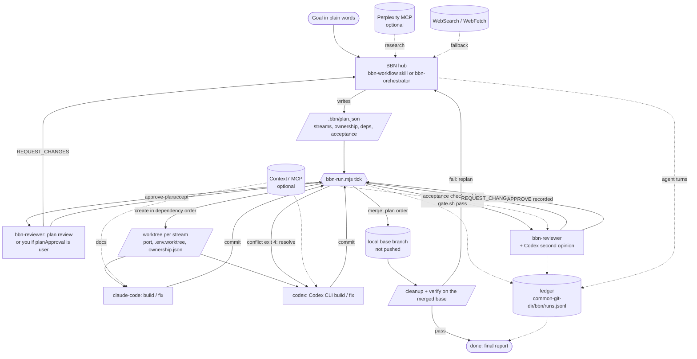

# BBN architecture - Boom Big Nose Workflow (v0.6.0)

BBN coordinates several AI agent roles in one workflow: a hub plans and dispatches, a harness does the mechanical steps and checks, each feature gets its own git worktree, and nothing reaches the base branch without passing a gate and an independent review. It started from the "Getting started with BBN" infographic (multi-agent roles, Perplexity MCP and Context7 MCP), extended with review, merge and isolation rules, and since v0.5 runs on autopilot.

> "Claude Code" and "Codex" here are **roles implemented as Claude Code subagents** in this plugin. Since v0.5 the `codex` role drives the real Codex CLI (`scripts/bbn-codex.sh`) with your own Codex login; nothing else logs in to an external product.

## Flow

## Roles

| Agent | Model | Job | Tools | maxTurns |
|---|---|---|---|---|
| hub: `bbn-workflow` skill (main thread) or `bbn-orchestrator` | Claude Opus 5.5, effort max | requirements, research, plan, harness ticks, dispatch | all | 150 (`bbn-orchestrator`) |
| `bbn-reviewer` | Claude Opus 5.5, effort high | approves or rejects the plan; reviews each branch with the gate results and a Codex second opinion; records the verdict | all except Write/Edit/NotebookEdit | 25 |
| `claude-code` | Claude Sonnet 5.5, effort high | implement, refactor or fix in one worktree, then commit | all | 40 |
| `codex` | Claude Haiku 5.5 driving the Codex CLI (`gpt-6.1-sol`, reasoning `xhigh`) | multi-file integration and conflict resolution; Codex edits the files, the driver checks and commits | all | 40 |

`maxTurns` in each agent's frontmatter is enforced by Claude Code; `bbn.config.json` holds the same numbers and `bbn-config-check.mjs` fails if they drift. The Codex model and effort come from `bbn.config.json` → `codex`, or `BBN_CODEX_MODEL` / `BBN_CODEX_EFFORT`. When the Codex CLI is not installed (`bbn-codex.sh` exit 3), the stream goes to `claude-code`; `/bbn-doctor` warns about it.

## Integration branch and final review (v0.6)

- `bbn-plan.mjs accept` names the run's branch `bbn/<slug(title)>-<hash6>` (hash of the accepted plan; slug lowercase, max 40 chars). A re-accept after a replan keeps the name; if that branch already has its final merge, the name is computed again from the plan hash, so an unchanged plan gets the same name and the run reports nothing to merge (change the plan to start a new run). `integration` is not part of the plan hash. The harness creates the branch from the **target** (the plan `base`, e.g. `main`) with `git branch --no-track`.
- Streams branch from the integration branch, are checked, gated and reviewed against it, and merge into it with `bbn-merge.sh --apply --base <integration>`. A plan stream can never merge into another base (`base-not-integration`, exit 3). The target is untouched.
- After the last stream: stream worktrees are cleaned up; a final worktree `<repo>-bbn-<name>` is created on the integration branch (reused if one exists) with a gate; if the target moved or the tree is dirty, `codex` merges the target into the integration branch (`git merge`, never rebase: it has merge commits); `verify` runs every acceptance check, the gate and the paths check; then `final-review`: `bbn-reviewer` reviews the whole `target...integration` diff, with `bbn-codex.sh review --base <target>`, and records `bbn-review-record.sh VERDICT --base <target>` in the final worktree.
- APPROVE: one `bbn-merge.sh --apply --base <target> --no-rebase` in the final worktree (`ask-merge` when `automation.merge` is `ask`). Exit 4 (target moved) goes back to `resolve`; exit 5 (stale) to a new `final-review`. REQUEST_CHANGES: `replan`, which adds a **fix stream under a new slug** and keeps the merged streams in the plan; the final paths check uses all of them. After `hardStopOnRepeatedFailures` REQUEST_CHANGES on the branch, or a BLOCK, the run stops. Then the final worktree is removed (branches are never deleted) and the run is `done`. Nothing is pushed.

## Guardrails (v0.6)

- **Secret scan** `bbn-plan.mjs scan [--base R]`: added lines of the net diff `merge-base..HEAD` plus every commit in the range (so a secret committed and then deleted is still caught; merge-conflict resolutions are included through `--diff-merges=remerge`), binary-looking files included (`--text`), plus added `.env` / `.env.*` files other than `.env.example`, `.env.sample`, `.env.template`. Patterns: AWS, private keys, GitHub, Slack, Stripe live, Anthropic and OpenAI-style keys, Google API keys, and quoted `key/secret/token/password` assignments of 16+ characters. A hit prints `file:line pattern-name` (and `@sha7` for history), never the value; a line containing `bbn-allow-secret` is skipped. Exit 0 clean, 3 hits, 2 usage or cannot scan. Octopus merges fail closed (`octopus-merge:0 unscanned`) and a patch over 64MB fails with exit 2 (`branch patch exceeds 64MB`). It runs in the stream check (`secret-scan`, then `fix`) and in `bbn-merge.sh` before the gate (any non-zero exit refuses with exit 3), also in the dry-run.
- **Path ownership** (`git diff --name-only --no-renames`, so a rename across the boundary lists both sides): files outside the stream's `paths` fail its acceptance run as `paths` and come back as `fix`; `verify` applies the union of all streams' paths to the whole integration diff.
- **Plan check** (`check`, `accept`, `apply` and the harness `create`, run against the main checkout, not every tick): an owned path that is gitignored with no tracked file under it is an error (worktrees will not carry it); one with tracked files is a warning; untracked, not-ignored files under an owned path in the main checkout are an error (worktrees start from git).
- **`--no-rebase`** on `bbn-merge.sh`: if the base moved, exit 4 instead of rebasing. Used for the final merge so reviewed commits are never rewritten.
- **Re-runs:** the acceptance checks re-run when the stream's acceptance commands or `paths` change, or when the integration head moves.
- **Known limitations:** the plan check reads the **main checkout's** working tree, not the plan `base` branch; keep the main checkout's `.gitignore` in line with the base and use trailing slashes for directory paths. `maxParallelWorktrees` counts merged streams too, so a plan at the limit cannot add a fix stream after a final REQUEST_CHANGES: keep plans one stream under the limit. `integration === target` is not rejected yet. Reviewer independence is not enforced mechanically; the diff size is limited only by the 64MB scan buffer; octopus merges are not scanned.

## Harness and autopilot (v0.5)

- **Autopilot.** The `bbn-workflow` skill starts on its own when you ask for a coding goal in a git repo that spans several files or parts; no slash command is needed. For a fully automatic session, start Claude Code with `claude --agent boom-big-nose-workflow:bbn-orchestrator`. The hub loops: `node scripts/bbn-run.mjs --apply --json` → dispatch the returned actions (all agent actions of one tick in parallel) → record each agent run in the ledger → tick again, until `done` or `stop`.
- **Harness** `scripts/bbn-run.mjs` reads the plan, the worktrees, the state files in each worktree's `<git-dir>/bbn/` (`accept.json`, `gate.json`, `review.json`) and the ledger. With `--apply` it does every mechanical step itself: create worktrees in dependency order, run each stream's acceptance checks on its HEAD, run the gate (when the project has no lint/typecheck/test it writes `.bbn/gate.sh` from the acceptance commands), merge approved branches into the run's integration branch one at a time in plan order, clean up, `verify` (every acceptance check, the gate and the paths check), and after the final review make the one merge into the local base (see "Integration branch and final review"). Without `--apply` it only shows the next actions; `bbn-run.mjs verify` checks the base now.
- **Agent actions** it returns: `plan`, `fix-plan`, `approve-plan`, `build`, `fix`, `review`, `final-review`, `resolve`, `ask-merge`, `replan`; plus `wait`, `stop` and `done`. Stream actions carry `base` = the integration branch; `final-review`, the final `resolve` and the final `ask-merge` carry `base` = the target. Mechanical steps it does itself: `integrate`, `create`, `check`, `gate`, `merge`, `cleanup`, `final-worktree`, `verify`, `final-merge`, `final-cleanup`.
- **Checkpoints.** By default `bbn-reviewer` approves the hub's plan (`bbn-plan.mjs accept --by reviewer`) and approved branches merge into the local base without asking. In `bbn.config.json` → `automation`, `planApproval: "user"` waits for your OK on the plan and `merge: "ask"` asks before each merge. The harness never pushes; pushing, PRs and deploying stay your call.
- **Stops.** A stream stops after `hardStopOnRepeatedFailures` (3) failed checks or reviews since its last approval, after a BLOCK, or when a step makes no progress. BBN reports the stream and why, and keeps driving the others. `done` means the one final merge into the target happened (after `verify` and the final review), or there was nothing to merge.

## Gate and merge

- `bbn-gate.sh`: `BBN_GATE_CMD` or `.bbn/gate.sh` if present (a non-executable one fails the gate), else auto-detect flutter / pnpm / yarn / bun / npm (lint, typecheck, test), cargo, go, pytest. Exit 0 pass, 1 fail, 2 nothing to run. The result is stored for the current commit in the worktree's git dir (`<git-dir>/bbn/gate.json`), never in the work tree.
- `bbn-review-record.sh`: stores the reviewer's verdict with a **patch fingerprint** (`git patch-id --verbatim` of the branch diff, git 2.39+). A clean rebase keeps the fingerprint; new commits, conflict edits and whitespace changes change it, so the approval no longer counts.
- `bbn-merge.sh`: dry-run by default. `--apply`: refuse without APPROVE, with a dirty tree or after a secret-scan hit (exit 3), refuse if the fingerprint changed, rebase on base (`--no-rebase`: exit 4 instead) (conflict, so exit 4 to Codex), re-check the fingerprint, run the gate on the rebased tree, then `merge --no-ff` into the local base in whichever worktree has it checked out (or a temporary one). It never pushes the base branch and never force-pushes. `--apply --pr` pushes the feature branch (no force) and opens a draft PR with `gh`.
- `bbn-status.sh`: every worktree with ahead/behind, dirty, gate/review state (`*` = recorded for an older commit), and files changed on more than one branch, the input for merge order.
- `bbn-plan.mjs`: the plan checkpoint as a file (see "Plan, queue, ledger"); `accept --by user|reviewer`, `apply --only SLUG --base REF`.
- `bbn-run.mjs`: the harness (see "Harness and autopilot").
- `bbn-codex.sh`: runs the Codex CLI in the current worktree. `run "<brief>"` edits files in a `workspace-write` sandbox and the caller commits; `review [--base REF]` is a read-only second opinion that ends with a `VERDICT` line. Exit 3 when the CLI is missing; limit `codex.timeoutSec`.
- `bbn-queue.mjs`: merge order with predicted conflicts (read-only).
- `bbn-cleanup.sh`: dry-run by default; removes clean worktrees of merged branches; `--delete-branches` uses `git branch -d` (merged only); `--include-unmerged` removes clean unmerged worktrees but keeps their branches.

## Plan, queue, ledger (v0.4)

- **Plan** `<main worktree>/.bbn/plan.json` (schema `bbn.plan.schema.json`, git-excluded). `check`: schema, stream count <= `maxParallelWorktrees`, `minAcceptanceChecks`, repo-relative paths, known dependencies without cycles, and file ownership: two streams may own overlapping paths only when one depends on the other (then it is a warning, because they merge in order). `accept` stores `planHash`; `apply --apply` refuses an unaccepted or edited plan (exit 3) and creates worktrees in topological order, writing role, paths, dependencies and acceptance into `.bbn/ownership.json`.
- **Queue** `bbn-queue.mjs` runs `git merge-tree --write-tree` for each branch against the base and for each pair of branches that touch the same files, without touching any checkout. Order: plan dependencies, then ready (gate + review recorded for the current commit), base conflicts, pairwise conflicts, overlaps, diff lines. `bbn-merge.sh --apply` enforces the dependency part (exit 3; `--ignore-order` overrides).
- **Ledger** `<common-git-dir>/bbn/runs.jsonl`: one JSON line per event, shared by all worktrees, never committed. Script events: `worktree.create`, `gate`, `review`, `merge` (`result` = merged / refused / conflict / stale_review / gate_failed / draft_pr), `merge.dryrun`, `plan.accept` (with `by`), `plan.apply`, `cleanup`; since v0.5 also `accept`, `run.merge`, `verify` (harness) and `codex` (`bbn-codex.sh`). The orchestrator adds `agent` events (`role`, `turns`, `status`). `bbn-report.mjs` sums them and flags runs that hit `maxTurns` (`partial`), failed, or exceeded budget; `--strict` exits 1 on any of these.
- **Exit codes** are shared by every script: [exit-codes.md](exit-codes.md).

## Isolation per worktree

`worktree-new.sh` gives each worktree a deterministic dev port (`portBase + cksum(slug) % portRange`), a `.env.worktree` (copied from `.env` when present, plus `BBN_DEV_PORT`/`PORT`), and `.bbn/ownership.json` (paths, DB branch `wt-<slug>`). Both are added to the repo's local `info/exclude`. Rules: one DB branch per worktree (for Supabase, a preview branch), base migrations before feature migrations, never a shared writable DB. The script refuses beyond `maxParallelWorktrees`.

## MCP routing

| Server | Used by | For | Auth | Fallback |
|---|---|---|---|---|
| Perplexity (`api.perplexity.ai/mcp`) | the hub only | research, current facts | sign-in via `/mcp` (OAuth) | WebSearch + WebFetch |
| Context7 (`mcp.context7.com/mcp`) | claude-code, codex, reviewer | library/API docs | none (optional key) | WebFetch official docs |

## Weakness -> fix

| Weakness (v0.1) | Fix | Since |
|---|---|---|
| No review/test gate before merge | `bbn-reviewer`, `bbn-gate.sh`, `/bbn-review`; merge requires a recorded APPROVE | 0.2.0, enforced in 0.3.0 |
| No conflict process | ownership maps, `/bbn-status` overlap report, rebase-before-merge, Codex owns conflicts, patch fingerprint forces re-review | 0.2.0 / 0.3.0 |
| BBN single point of failure | plan checkpoint + re-plan, independent reviewer, decision log | 0.2.0 |
| No budgets | `bbn.config.json` + enforced `maxTurns`; worktree cap in `worktree-new.sh` | 0.2.0 / 0.3.0 |
| Shared DB/ports/env | per-worktree port, `.env.worktree`, DB branch rule, migration order | 0.2.0 |
| MCP use undefined | routing table; agents can now actually reach MCP (denylist, not allowlist); fallbacks; doctor fix hints | 0.2.0 / 0.3.0 / 0.4.0 |
| Plan checkpoint only in the prompt | `.bbn/plan.json` + `bbn-plan.mjs` (accept hash, apply refuses changed plans) | 0.4.0 |
| Merge order a judgement call; conflicts found at rebase | `/bbn-queue` with `git merge-tree` prediction; merge refuses unmerged plan dependencies | 0.4.0 |
| Budgets enforced but invisible | run ledger + `/bbn-report` (turns vs `maxTurns`) | 0.4.0 |
| A hung gate step could block forever | per-step timeout `stepTimeoutSec` | 0.4.0 |
| Every step waited for a slash command | `bbn-workflow` skill on autopilot + `bbn-run.mjs` harness; human checkpoints opt-in via `automation` | 0.5.0 |
| Builders checked their own work | harness runs the acceptance checks and gate on the exact commit; reviewer gets a Codex second opinion | 0.5.0 |
| Retries could loop forever | stop after `hardStopOnRepeatedFailures` failed checks or reviews, or a step with no progress | 0.5.0 |
| Streams merged straight into the target, each seen alone | per-run integration branch; `final-review` of the whole diff before one merge into the target (ADR-0004) | 0.6.0 |
| Secrets or out-of-scope files could ride along | secret scan, path ownership, plan checks for gitignored/untracked owned paths | 0.6.0 |

## Changes in v0.3.0

- **Perplexity 401 fixed**: the empty `Bearer ${PERPLEXITY_API_KEY}` header (key not set) caused 401 and blocked OAuth. The plugin now uses sign-in; API key is an opt-in route (README). See ADR-0002.
- **Agents could not use MCP**: `tools:` allowlists hid MCP tools; switched to `disallowedTools`. `color: magenta` (invalid) -> `purple`. `maxTurns` added.
- **Merge rewritten**: v0.2 ran the gate before rebasing and tried to `checkout` the base inside the feature worktree (fails when base is checked out elsewhere). Now: rebase, then gate, then fingerprint check, then merge in the base worktree.
- **New**: `/bbn-doctor`, `/bbn-status`, `/bbn-cleanup`, `bbn-review-record.sh`, draft-PR path, GitHub Actions template, JSON schema + validator, bash test suite, CHANGELOG.

## Changes in v0.4.0

- **Plan checkpoint enforced** by `/bbn-plan` (ADR-0003).
- **Merge queue** with predicted conflicts, and ordered merges.
- **Ledger + report** of turns per agent vs budget.
- **Hardening**: gate step timeout, shared exit codes, `GIT_TERMINAL_PROMPT=0`, shellcheck-clean scripts, doctor fix hints and 401 guard, feature branches created without upstream tracking (cleanup could not delete them).
- **Tests**: `tests/smoke.sh` end-to-end dry run in a temp repo, plus unit tests for every new script.

## Changes in v0.5.0

- **Removed (breaking)**: the `grok-build` agent. The hub (the `bbn-workflow` skill, or `bbn-orchestrator` as the main agent) plans and researches itself; Perplexity is routed to the hub only.
- **Autopilot**: the `bbn-workflow` skill starts on its own for a multi-part coding goal in a git repo and runs the whole loop with no slash commands. The `/bbn-*` commands stay as manual controls.
- **Harness** `bbn-run.mjs`: worktrees, acceptance checks, gate, local merges in plan order, cleanup and a final `verify` of the merged base; it stops a stream instead of looping and never pushes.
- **Real Codex CLI** through `bbn-codex.sh` (`run` to edit, `review` for a second opinion); the `codex` role drives it, `claude-code` takes over when it is missing.
- **Model tiers**: hub and reviewer on Claude Opus 5.5 (effort max / high), `claude-code` on Claude Sonnet 5.5, `codex` on Claude Haiku 5.5 driving `gpt-6.1-sol` at `xhigh`.
- **Checkpoints**: the reviewer approves the plan and approved branches merge into the local base by default; `automation.planApproval: "user"` and `automation.merge: "ask"` bring the human checkpoints back.

## Changes in v0.6.0

- **Integration branch** `bbn/<title>-<hash6>` per run; streams merge into it; the target is untouched until the final merge.
- **Final review gate** (`final-review`): the whole `target...integration` diff is reviewed with a Codex second opinion; one `--no-rebase` merge into the target after APPROVE. A moved target is merged into the integration branch, never rebased.
- **Guardrails:** secret scan (`bbn-plan.mjs scan`), path ownership, plan checks for gitignored and untracked owned paths, acceptance re-runs when acceptance or paths change.
- Out of scope: mechanical reviewer-independence enforcement, a maximum diff size beyond the 64MB scan buffer, scanning octopus merges.

## Decision log

`docs/decisions/` holds this plugin's ADRs (0001 review gate, 0002 Perplexity sign-in, 0003 plan file + ledger + merge queue, 0004 final review gate) and `ADR-TEMPLATE.md` for projects that use BBN.
